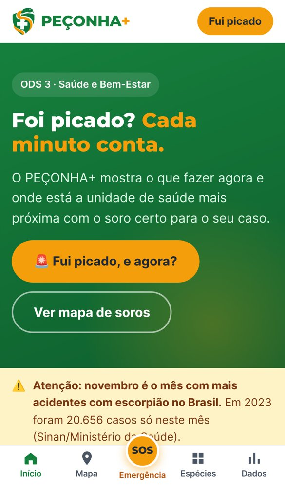
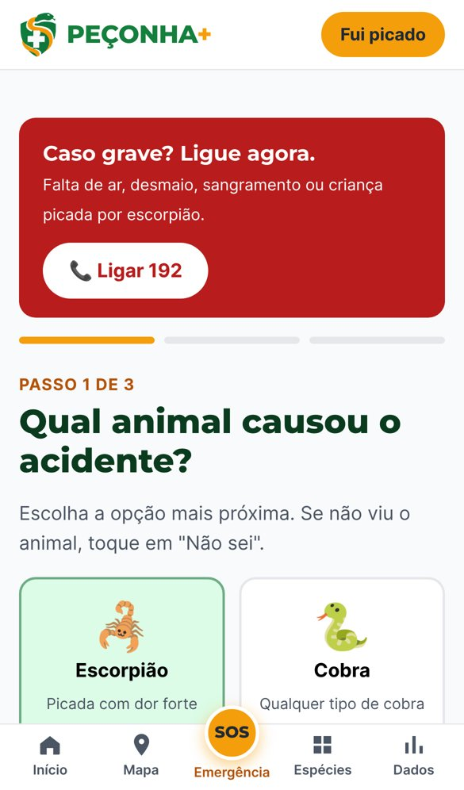
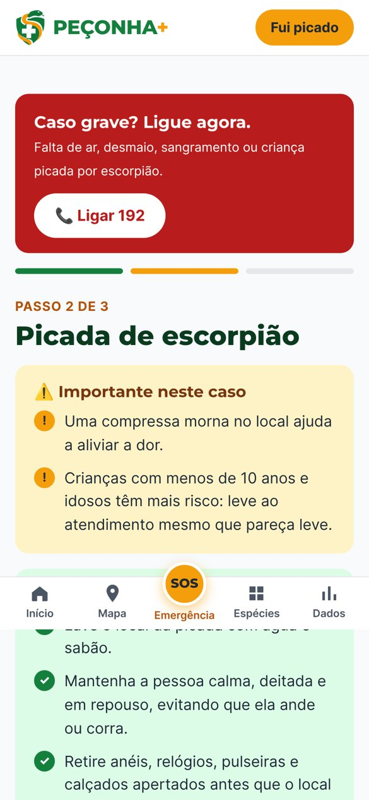
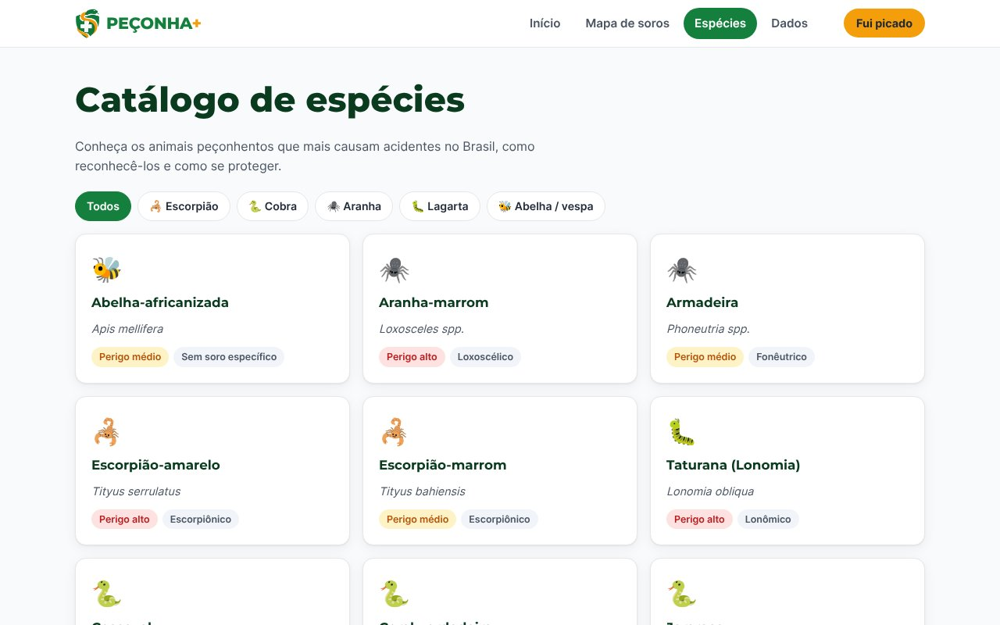
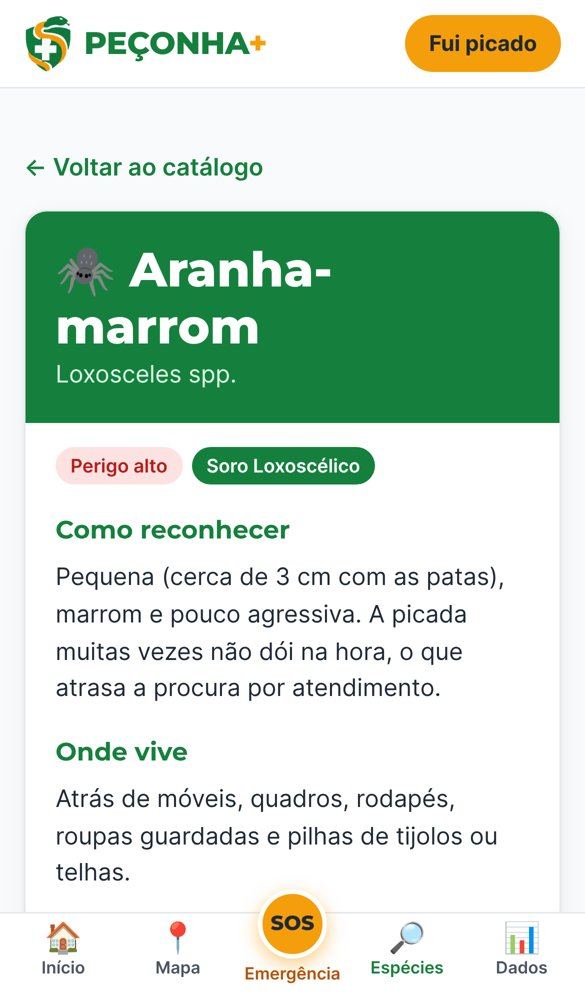
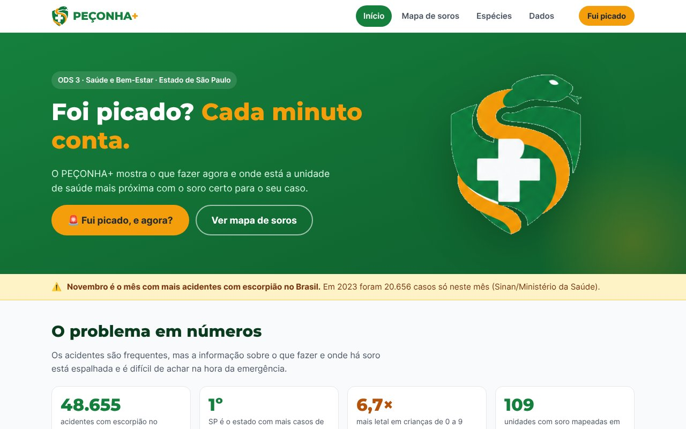
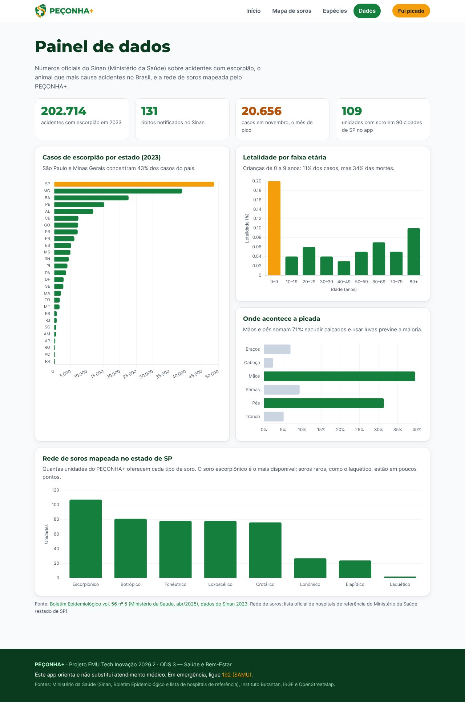

# 🐍 PEÇONHA+ — Prevenção e Informação sobre Animais Peçonhentos

> Web App responsivo que orienta os primeiros socorros em acidentes com animais peçonhentos e mostra a unidade de saúde mais próxima com o soro antiveneno adequado. Projeto desenvolvido para o programa **FMU Tech Inovação 2026.2** (ODS 3 — Saúde e Bem-Estar).

   

**Sumário:** [Problema](#-1-descrição-do-problema-e-aderência-ao-ods-3) · [Solução](#-2-proposta-de-solução-tecnológica) · [Protótipo](#-3-protótipo-funcional-checkpoint-2) · [Como executar](#️-4-como-executar) · [Tecnologias](#️-5-arquitetura-tecnologias-e-justificativas) · [Dados](#-6-bases-de-dados-públicas) · [Identidade visual](#-7-identidade-visual) · [Pitch](#-8-pitch) · [Equipe](#-9-integrantes-do-grupo)

---

## 🎯 1. Descrição do Problema e Aderência ao ODS 3

**O problema de saúde pública**
Em 2023, o Brasil registrou **344.138 acidentes com animais peçonhentos** no Sinan, dos quais **202.714 foram com escorpiões** (59%). Os dados existem, mas a informação útil para o cidadão está **dispersa e pouco acessível na hora da emergência**: as orientações de primeiros socorros ficam em sites diferentes, e a lista de hospitais com soro antiveneno é publicada pelo Ministério da Saúde em PDFs separados por estado. Isso atrasa o atendimento, e o tempo importa: a letalidade do escorpionismo sobe de 0,05% (atendimento em até 1 hora) para 0,12% (12 a 24 horas).

**Público afetado**
Moradores de áreas urbanas e rurais (66% dos acidentes com escorpião acontecem na cidade), com atenção especial a **crianças de 0 a 9 anos**, que somam 11% dos casos mas 34% das mortes, e aos seus pais e cuidadores.

**Aderência ao ODS 3 (Saúde e Bem-Estar)**
* Redução de agravos e mortes evitáveis causados por animais peçonhentos (meta 3.9 e 3.d).
* Divulgação acessível dos protocolos oficiais de primeiros socorros.
* Acesso mais rápido às unidades de saúde que têm o soro antiveneno correto.

## 💡 2. Proposta de Solução Tecnológica

O **PEÇONHA+** reúne em um Web App (celular e computador, sem instalar nada) o que a pessoa precisa nos primeiros minutos após um acidente:

| Funcionalidade | Status no Checkpoint 2 |
|---|---|
| **Fluxo de emergência guiado** (animal → primeiros socorros → atendimento) | ✅ Implementado |
| **Mapa de unidades com soro antiveneno**, filtrável por tipo de soro | ✅ Implementado (estado de SP) |
| **Busca da unidade mais próxima** por geolocalização ou cidade | ✅ Implementado |
| **Catálogo de espécies** com reconhecimento, sintomas e prevenção | ✅ Implementado |
| **Painel de dados epidemiológicos** (Sinan) | ✅ Implementado |
| **Registro comunitário de avistamentos** | 🔜 Próxima etapa |

## 📱 3. Protótipo Funcional (Checkpoint 2)

### Fluxo principal: "Fui picado, e agora?"

1. **Passo 1 — Qual animal?** A pessoa escolhe escorpião, cobra, aranha, lagarta, abelha ou "não sei". Para cobras e aranhas, pode indicar a espécie (opcional).
2. **Passo 2 — Primeiros socorros.** O app mostra o que fazer, o que **não** fazer, cuidados específicos do animal e os sinais de alarme que exigem ligar para o 192.
3. **Passo 3 — Onde buscar atendimento.** Com a localização do celular (ou a cidade digitada), a API calcula as **5 unidades mais próximas que têm o soro necessário**, com distância, telefone (toque para ligar) e rota.

| Início (mobile) | Passo 1 | Passo 2 |
|---|---|---|
|  |  |  |

| Catálogo de espécies | Detalhe da espécie |
|---|---|
|  |  |

**Página inicial (desktop)**


**Painel de dados (Sinan 2023)**


🎥 **Vídeo de demonstração (até 3 min):** _link a adicionar_

## ▶️ 4. Como executar

**Pré-requisitos:** Python 3.10 ou superior e Git.

```bash
# 1. Clonar o repositório
git clone https://github.com/danielpassiani/peconha-fmu-tech.git
cd peconha-fmu-tech

# 2. Criar e ativar um ambiente virtual
python -m venv .venv
# Windows:
.venv\Scripts\activate
# Linux/macOS:
source .venv/bin/activate

# 3. Instalar as dependências
pip install -r requirements.txt

# 4. Iniciar (o banco SQLite é criado automaticamente na primeira execução)
python run.py
```

Acesse **http://localhost:5000** no navegador. Para testar no celular, use o IP do computador na mesma rede Wi-Fi (ex.: `http://192.168.0.10:5000`).

**Atalho no Windows:** dê dois cliques em `iniciar.bat` (cria o ambiente, instala tudo e abre o navegador).
**No VS Code:** abra a pasta, instale as extensões recomendadas e aperte **F5** para rodar com o depurador.

**Recriar o banco do zero:** `python -m app.seed`
**Rodar os testes automatizados:** `python -m pytest`

> A geolocalização do navegador só funciona em `localhost` ou em HTTPS. Pelo IP da rede, use o campo "escolha sua cidade".

## 🛠️ 5. Arquitetura, Tecnologias e Justificativas

```
Navegador (HTML/CSS/JS + Leaflet + Chart.js)
        │  fetch() JSON
        ▼
API REST (Python + Flask)  ──►  SQLite (modelo relacional)
        ▲                              ▲
        └──── app/seed.py carrega ─────┘
              data/ (CSV e JSON das bases públicas)
```

| Camada | Tecnologia | Justificativa |
|---|---|---|
| Frontend | HTML5, CSS3 e JavaScript puro | Web App responsivo, roda em qualquer celular sem instalação. Mobile-first, com navegação inferior e botão de emergência sempre visível. |
| Mapas | Leaflet + OpenStreetMap | Mapas interativos open-source, sem chave de API nem custo. |
| Gráficos | Chart.js | Gráficos leves e acessíveis no navegador. |
| Backend | Python + Flask | Aproveita o domínio da equipe em Python para uma API REST simples e organizada em blueprints. |
| Banco de dados | SQLite | Modelo relacional normalizado (municípios, unidades, soros, espécies e tabelas associativas N:N), sem servidor para instalar. Migrável para PostgreSQL em produção. |
| Testes | pytest | Testes automatizados da API, da busca por proximidade e da carga de dados. |
| Versionamento | Git + GitHub | Organização das entregas colaborativas. |

**Estrutura de pastas**

```
├── app/
│   ├── __init__.py        # criação da aplicação Flask
│   ├── api.py             # endpoints REST (/api/...)
│   ├── pages.py           # rotas das páginas
│   ├── db.py              # conexão SQLite
│   ├── schema.sql         # modelo relacional
│   ├── seed.py            # carga das bases públicas no banco
│   ├── templates/         # páginas HTML (Jinja)
│   └── static/            # CSS, JS, imagens e bibliotecas
├── data/
│   ├── raw/               # CSVs das bases públicas (MS e IBGE)
│   ├── especies.json
│   ├── primeiros_socorros.json
│   └── estatisticas.json  # Sinan 2023
├── docs/                  # identidade visual e prints
├── tests/                 # testes automatizados
└── run.py                 # ponto de entrada
```

**Modelo de dados**

```
municipio (codigo_ibge PK, nome, uf, latitude, longitude)
    1 ── N  unidade (id PK, nome, endereco, telefone, cnes, codigo_municipio FK, latitude, longitude)
                N ── N  soro (codigo PK, nome, indicacao)      via unidade_soro
especie (id PK, nome, cientifico, grupo, perigo, ...)
                N ── N  soro                                    via especie_soro
```

**Endpoints da API**

| Método | Rota | Descrição |
|---|---|---|
| GET | `/api/unidades?soro=botropico,crotalico&municipio=3550308` | Unidades, filtradas por soro e município |
| GET | `/api/unidades/proximas?lat=-23.55&lon=-46.63&soro=escorpionico&limite=5` | Unidades mais próximas (fórmula de Haversine) |
| GET | `/api/primeiros-socorros/<grupo>` | Orientações por animal (`escorpiao`, `serpente`, `aranha`, `lagarta`, `abelha`, `desconhecido`) |
| GET | `/api/especies` · `/api/especies/<id>` | Catálogo de espécies |
| GET | `/api/municipios` | Municípios de SP com coordenadas |
| GET | `/api/soros` | Tipos de soro antiveneno |
| GET | `/api/estatisticas` | Dados do Sinan e resumo da rede de soros |

## 📊 6. Bases de Dados Públicas

| Base | Uso no app | Fonte |
|---|---|---|
| **Sinan — Boletim Epidemiológico vol. 56 nº 5 (2025)** | Painel de dados: casos por UF, faixa etária, local da picada, sazonalidade | [Ministério da Saúde](https://www.gov.br/saude/pt-br/assuntos/saude-de-a-a-z/a/animais-peconhentos/boletins-epidemiologicos/boletim-epidemiologico-vol-56-no-5) |
| **Hospitais de referência para atendimento (SP)** | Unidades com soro antiveneno, endereço, telefone, CNES e soros disponíveis | [Ministério da Saúde](https://www.gov.br/saude/pt-br/assuntos/saude-de-a-a-z/a/animais-peconhentos/hospitais-de-referencia/hospitais-de-referencia-para-atendimento) |
| **Municípios brasileiros (IBGE)** | Código IBGE e coordenadas dos 645 municípios de SP | [kelvins/municipios-brasileiros](https://github.com/kelvins/municipios-brasileiros) |
| **Orientações de primeiros socorros** | Conteúdo do fluxo de emergência | Ministério da Saúde e Instituto Butantan |
| **OpenStreetMap** | Mapa base | [openstreetmap.org](https://www.openstreetmap.org) |

**Limitações conhecidas do protótipo**
* O mapa cobre **109 unidades em 90 municípios do estado de SP**, transcritas da lista oficial do Ministério da Saúde. A expansão para a lista completa e para outros estados está prevista.
* A posição das unidades no mapa é **aproximada** (centro do município, ou do bairro na capital). A próxima etapa é geocodificar os endereços.
* A disponibilidade de soro pode mudar: o app orienta ligar antes para a unidade.

## 🎨 7. Identidade Visual


* **Logo:** escudo de proteção/saúde com a silhueta de uma serpente e a cruz médica.
* **Paleta de cores:**
  * **Verde Preservação** (`#15803D`): meio ambiente e biologia das espécies.
  * **Amarelo/Laranja Alerta** (`#F59E0B`): atenção, prevenção e urgência médica.
  * **Cinza/Branco Neutro** (`#F8FAFC`): fundo de alta legibilidade.
* **Tipografia:** **Montserrat** nos títulos e **Inter** nos textos.

A identidade foi aplicada em todo o protótipo: botões de emergência em laranja, ações seguras em verde e alertas críticos em vermelho.

## ⚡ 8. Pitch

"Todo ano, mais de 340 mil brasileiros sofrem acidentes com animais peçonhentos, e nos primeiros minutos ninguém sabe o que fazer nem onde há soro. O **PEÇONHA+** resolve isso em três toques: diga qual animal foi, veja os primeiros socorros oficiais e encontre a unidade mais próxima com o soro certo. Tudo com dados públicos do Ministério da Saúde, em um Web App que abre em qualquer celular, alinhado ao ODS 3 de promover o bem-estar e salvar vidas."

## 🔜 Próximos passos

* Registro comunitário de avistamentos com mapa de calor.
* Lista completa de unidades de SP e expansão para todos os estados.
* Geocodificação dos endereços das unidades.
* Funcionamento offline (PWA) para áreas rurais sem sinal.

## 👥 9. Integrantes do Grupo

* Eduardo Prado da Silva ([@PRADOZZZ](https://github.com/PRADOZZZ))
* Daniel dos Santos Bonilho Passiani ([@danielpassiani](https://github.com/danielpassiani))
* Augusto Andrade Silva ([@augustoandradesilva7-art](https://github.com/augustoandradesilva7-art))
* Letícia Souza Pessoa ([@leticialele12384-png](https://github.com/leticialele12384-png))
* Pedro de Siqueira Torres ([@PedroTorres15](https://github.com/PedroTorres15))

> ⚠️ O PEÇONHA+ é um projeto acadêmico de orientação e **não substitui atendimento médico**. Em emergência, ligue **192 (SAMU)**.

*Checkpoint 2 — FMU Tech Inovação 2026.2 · Análise e Desenvolvimento de Sistemas, 2º semestre.*
