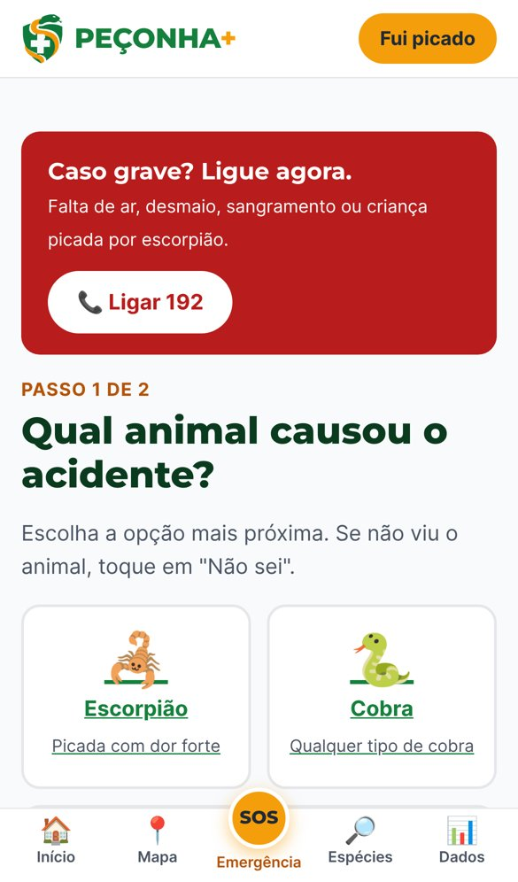
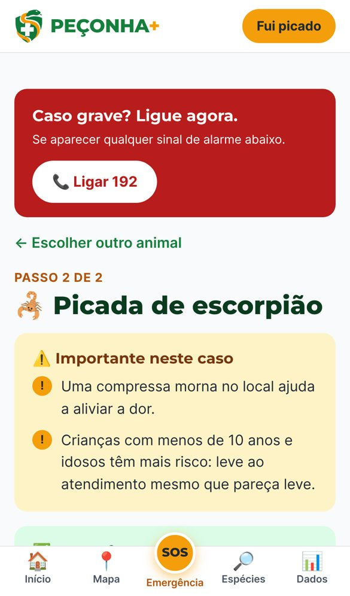
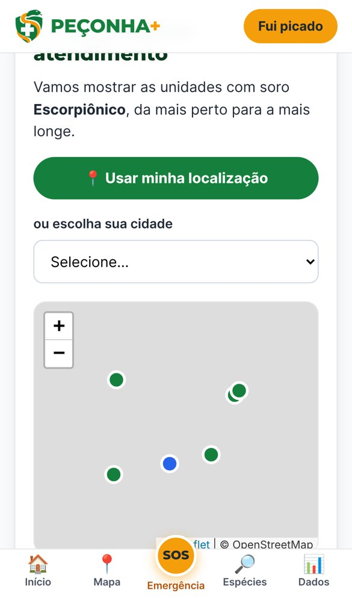
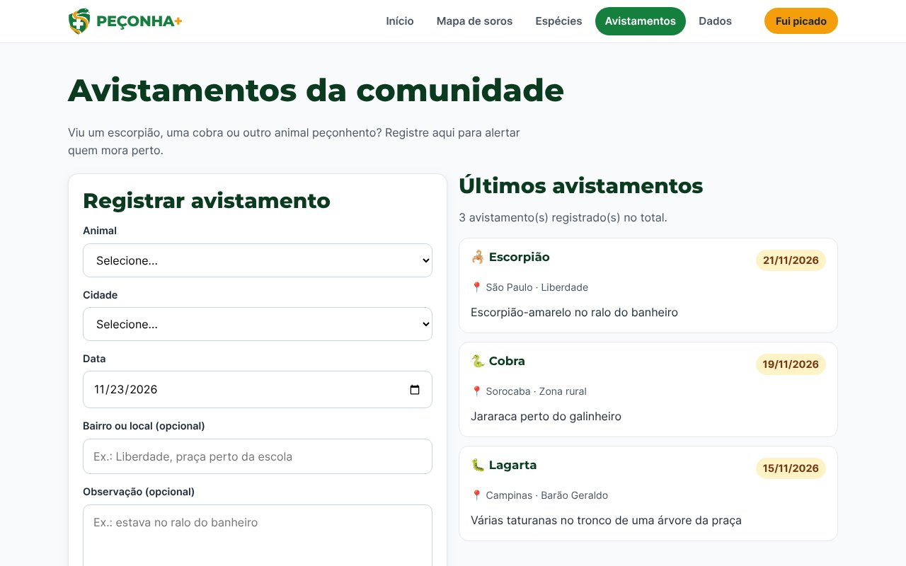
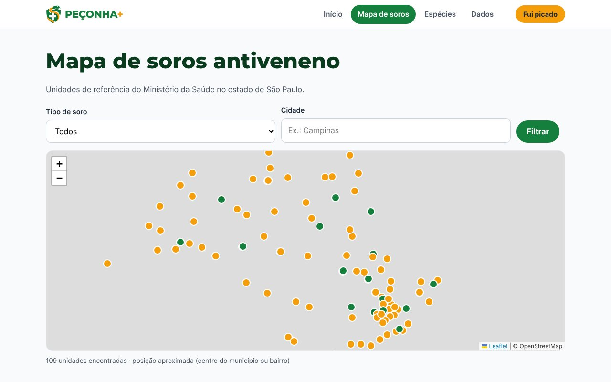
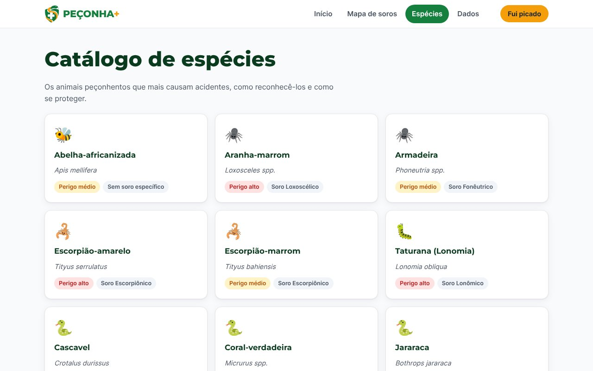
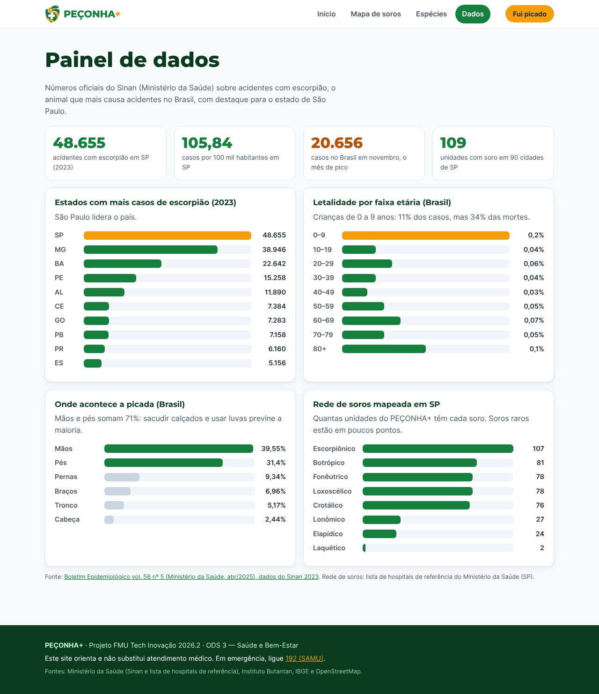

# 🐍 PEÇONHA+ — Prevenção e Informação sobre Animais Peçonhentos

> Web App responsivo que orienta os primeiros socorros em acidentes com animais peçonhentos e mostra a unidade de saúde mais próxima com o soro antiveneno adequado, no **estado de São Paulo**. Projeto desenvolvido para o programa **FMU Tech Inovação 2026.2** (ODS 3 — Saúde e Bem-Estar).

**Sumário:** [Problema](#-1-descrição-do-problema-e-aderência-ao-ods-3) · [Solução](#-2-proposta-de-solução-tecnológica) · [Protótipo](#-3-protótipo-funcional-checkpoint-2) · [Como executar](#️-4-como-executar) · [Tecnologias](#️-5-arquitetura-tecnologias-e-justificativas) · [Dados](#-6-bases-de-dados-públicas) · [Identidade visual](#-7-identidade-visual) · [Pitch](#-8-pitch) · [Equipe](#-9-integrantes-do-grupo)

---

## 🎯 1. Descrição do Problema e Aderência ao ODS 3

**O problema de saúde pública**
Em 2023, o Brasil registrou **344.138 acidentes com animais peçonhentos** no Sinan, dos quais **202.714 foram com escorpiões** (59%). **São Paulo é o estado com mais casos de escorpião do país: 48.655 em 2023.** Os dados existem, mas a informação útil para o cidadão está **dispersa e pouco acessível na hora da emergência**: as orientações de primeiros socorros ficam em sites diferentes, e a lista de hospitais com soro antiveneno é publicada pelo Ministério da Saúde em PDFs. Isso atrasa o atendimento, e o tempo importa: a letalidade do escorpionismo sobe de 0,05% (atendimento em até 1 hora) para 0,12% (12 a 24 horas).

**Público afetado**
Moradores do estado de São Paulo, de áreas urbanas e rurais (66% dos acidentes com escorpião acontecem na cidade), com atenção especial a **crianças de 0 a 9 anos**, que somam 11% dos casos mas 34% das mortes, e aos seus pais e cuidadores.

**Recorte do projeto**
Nesta versão, o PEÇONHA+ cobre **apenas o estado de São Paulo**, onde estão a equipe e o maior número de casos de escorpião do Brasil.

**Aderência ao ODS 3 (Saúde e Bem-Estar)**
* Redução de agravos e mortes evitáveis causados por animais peçonhentos.
* Divulgação acessível dos protocolos oficiais de primeiros socorros.
* Acesso mais rápido às unidades de saúde que têm o soro antiveneno correto.
* Prevenção de acidentes com dicas de cuidado e com o registro comunitário de avistamentos.

## 💡 2. Proposta de Solução Tecnológica

O **PEÇONHA+** reúne em um Web App (celular e computador, sem instalar nada) o que a pessoa precisa nos primeiros minutos após um acidente:

| Funcionalidade | Status |
|---|---|
| **Primeiros socorros por animal** (o que fazer, o que não fazer, sinais de alarme) | ✅ Implementado |
| **Unidade mais próxima com o soro certo** (localização do celular ou cidade) | ✅ Implementado |
| **Mapa de unidades com soro antiveneno** em SP, com filtro por soro e cidade | ✅ Implementado |
| **Catálogo de espécies** | ✅ Implementado |
| **Painel de dados** do Sinan | ✅ Implementado |
| **Registro comunitário de avistamentos** | ✅ Implementado |

## 📱 3. Projeto Funcionando

### Fluxo principal: "Fui picado, e agora?"

1. **Escolher o animal:** escorpião, cobra, aranha, lagarta, abelha ou "não sei".
2. **Ver os primeiros socorros:** o que fazer, o que **não** fazer, cuidados específicos do animal e sinais de alarme para ligar 192.
3. **Encontrar atendimento:** com a localização do celular (ou escolhendo a cidade), o sistema mostra as **5 unidades mais próximas que têm o soro necessário**, com distância, telefone e rota.

| Início | Escolha do animal | Primeiros socorros | Atendimento |
|---|---|---|---|
|  |  |  |  |

### Registro comunitário de avistamentos

Qualquer pessoa pode registrar que viu um animal peçonhento, informando o animal, a cidade, a data e uma observação. Os registros ficam salvos no banco de dados e aparecem na lista de últimos avistamentos, ajudando a alertar quem mora na mesma região.



**Mapa de soros**


**Catálogo de espécies**


**Painel de dados (Sinan 2023)**


🎥 **Vídeo de demonstração (até 3 min):** [Assista no YouTube](https://youtu.be/HioajYKRvzo)

## ▶️ 4. Como executar

**Pré-requisitos:** Python 3.10 ou superior e Git.

```bash
# 1. Clonar o repositório
git clone https://github.com/danielpassiani/peconha-fmu-tech.git
cd peconha-fmu-tech

# 2. Criar e ativar um ambiente virtual
python -m venv .venv
.venv\Scripts\activate        # Windows
# source .venv/bin/activate   # Linux/macOS

# 3. Instalar o Flask
pip install -r requirements.txt

# 4. Rodar (o banco SQLite é criado sozinho na primeira vez)
python app.py
```

Acesse **http://localhost:5000** no navegador.

**Atalho no Windows:** dê dois cliques em `iniciar.bat`.
**Recriar o banco do zero:** `python database.py`

## 🛠️ 5. Arquitetura, Tecnologias e Justificativas

```
Navegador (HTML, CSS, JavaScript e Leaflet)
        │
        ▼
Python + Flask (app.py)  ──►  SQLite (peconha.db)
                                  ▲
        database.py lê os CSV e JSON da pasta data/
```

| Camada | Tecnologia | Justificativa |
|---|---|---|
| Prototipação | Figma | Ideação rápida das telas e colaboração em tempo real. |
| Frontend | HTML5, CSS3 e JavaScript | Web App responsivo que abre em qualquer celular, sem instalar aplicativo. |
| Backend | Python + Flask | Aproveita o domínio da equipe em Python. As páginas são montadas com os templates do Flask (Jinja). |
| Banco de dados | SQLite | Aplicação da disciplina de Banco de Dados com modelagem relacional, sem precisar instalar servidor. Pode migrar para PostgreSQL no futuro. |
| Mapas | Leaflet + OpenStreetMap | Mapas interativos gratuitos e open-source. |
| Versionamento | Git + GitHub | Organização das entregas da equipe. |

**Estrutura de pastas**

```
peconha-fmu-tech/
├── app.py              # rotas do Flask (páginas e API)
├── database.py         # cria o banco e carrega os dados
├── schema.sql          # tabelas do banco
├── requirements.txt    # dependências (Flask)
├── iniciar.bat         # atalho para rodar no Windows
├── data/               # bases públicas (CSV e JSON)
├── templates/          # páginas HTML
├── static/             # CSS, JavaScript e imagens
└── docs/               # identidade visual e prints
```

**Modelo de dados**

```
municipio (codigo_ibge, nome, latitude, longitude)
    │ 1:N
unidade (id, nome, endereco, telefone, cnes, codigo_ibge, latitude, longitude)
    │ N:N  (tabela unidade_soro)
soro (codigo, nome, animal)
    │ 1:N
especie (id, nome, cientifico, grupo, perigo, soro_codigo, descricao, habitat, sintomas, prevencao)

municipio 1:N avistamento (id, grupo, codigo_ibge, data, bairro, observacao, criado_em)
```

**Rotas**

| Rota | O que faz |
|---|---|
| `/` | Página inicial |
| `/emergencia` | Escolha do animal |
| `/emergencia/<animal>` | Primeiros socorros e busca de atendimento |
| `/mapa?soro=&cidade=` | Mapa e lista de unidades com filtros |
| `/especies` e `/especies/<id>` | Catálogo e detalhe das espécies |
| `/avistamentos` | Formulário e lista de avistamentos da comunidade |
| `/dados` | Painel de dados |
| `/api/unidades/proximas?lat=&lon=&grupo=` | Retorna em JSON as 5 unidades mais próximas com o soro do animal (usada pelo JavaScript) |

A distância entre a pessoa e cada unidade é calculada em Python com a **fórmula de Haversine** (distância entre dois pontos de latitude e longitude).

## 📊 6. Bases de Dados Públicas

| Base | Uso no app | Fonte |
|---|---|---|
| **Sinan — Boletim Epidemiológico vol. 56 nº 5 (2025)** | Painel de dados e números do problema | [Ministério da Saúde](https://www.gov.br/saude/pt-br/assuntos/saude-de-a-a-z/a/animais-peconhentos/boletins-epidemiologicos/boletim-epidemiologico-vol-56-no-5) |
| **Hospitais de referência para atendimento (SP)** | Unidades com soro: endereço, telefone, CNES e soros disponíveis | [Ministério da Saúde](https://www.gov.br/saude/pt-br/assuntos/saude-de-a-a-z/a/animais-peconhentos/hospitais-de-referencia/hospitais-de-referencia-para-atendimento) |
| **Municípios de SP (IBGE)** | Código IBGE e coordenadas das 645 cidades | [kelvins/municipios-brasileiros](https://github.com/kelvins/municipios-brasileiros) |
| **Orientações de primeiros socorros** | Conteúdo das páginas de emergência | Ministério da Saúde e Instituto Butantan |
| **OpenStreetMap** | Mapa base | [openstreetmap.org](https://www.openstreetmap.org) |

**Limitações do protótipo**
* O mapa tem **109 unidades em 90 cidades de SP**, retiradas da lista oficial do Ministério da Saúde. A próxima etapa é incluir a lista completa do estado.
* A posição das unidades no mapa é **aproximada** (centro da cidade, ou do bairro na capital).
* A disponibilidade de soro pode mudar: o app orienta ligar antes para a unidade.
* Os dados das unidades foram conferidos com o PDF oficial do Ministério da Saúde
## 🎨 7. Identidade Visual


* **Logo:** escudo de proteção/saúde com a silhueta de uma serpente e a cruz médica.
* **Paleta de cores:**
  * **Verde Preservação** (`#15803D`): meio ambiente e biologia das espécies.
  * **Amarelo/Laranja Alerta** (`#F59E0B`): atenção, prevenção e urgência médica.
  * **Cinza/Branco Neutro** (`#F8FAFC`): fundo de alta legibilidade.
* **Tipografia:** **Montserrat** nos títulos e **Inter** nos textos.

## ⚡ 8. Pitch

"São Paulo é o estado com mais acidentes com escorpião do Brasil: quase 50 mil por ano. Nos primeiros minutos, ninguém sabe o que fazer nem onde há soro. O **PEÇONHA+** resolve isso em poucos toques: diga qual animal foi, veja os primeiros socorros oficiais e encontre a unidade mais próxima com o soro certo. Tudo com dados públicos do Ministério da Saúde, em um Web App que abre em qualquer celular, alinhado ao ODS 3 de promover o bem-estar e salvar vidas."

## 🔜 Próximos passos

* Mapa com os avistamentos registrados pela comunidade.
* Lista completa de unidades do estado de SP.
* Posição exata das unidades no mapa (a partir do endereço).

## 👥 9. Integrantes do Grupo e Contribuições

| Integrante | Contribuição |
|---|---|
| Daniel dos Santos Bonilho Passiani | Desenvolvimento do sistema (Flask, banco de dados e páginas) e identidade visual |
| Augusto Andrade Silva | Levantamento e conferência das bases de dados públicas |
| Letícia Souza Pessoa | Conteúdo e revisão das orientações de primeiros socorros |
| Pedro de Siqueira Torres | Pitch e apresentação do projeto |
| Eduardo Prado da Silva | Documentação e próximos passos |

**Perfis no GitHub:**

* Eduardo Prado da Silva ([@PRADOZZZ](https://github.com/PRADOZZZ))
* Daniel dos Santos Bonilho Passiani ([@danielpassiani](https://github.com/danielpassiani))
* Augusto Andrade Silva ([@augustoandradesilva7-art](https://github.com/augustoandradesilva7-art))
* Letícia Souza Pessoa ([@leticialele12384-png](https://github.com/leticialele12384-png))
* Pedro de Siqueira Torres ([@PedroTorres15](https://github.com/PedroTorres15))

> ⚠️ O PEÇONHA+ é um projeto acadêmico e **não substitui atendimento médico**. Em emergência, ligue **192 (SAMU)**.

*Entrega final — FMU Tech Inovação 2026.2 · Análise e Desenvolvimento de Sistemas, 2º semestre.*
